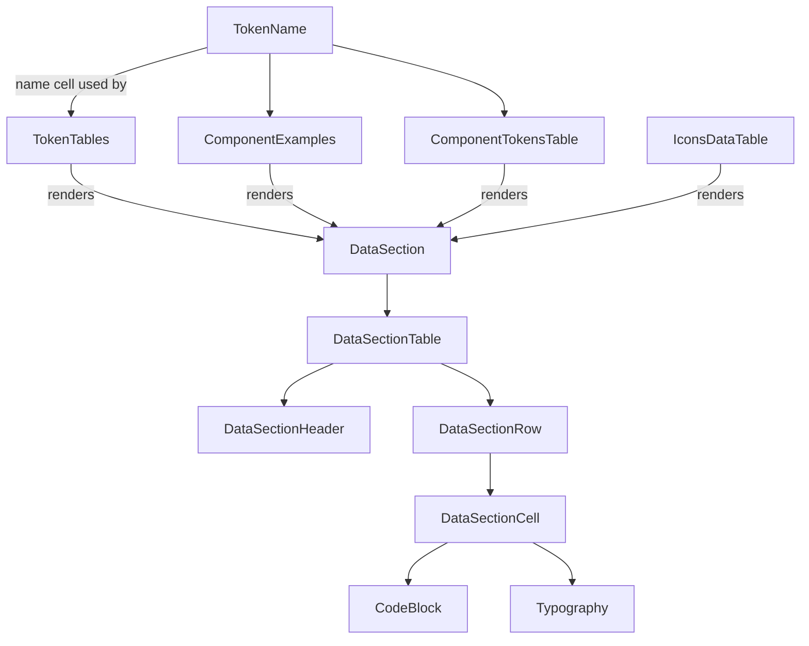

# How the table components relate

No class inheritance. `DataSection` is the base table engine; the other four are
config wrappers that **render `<DataSection>`** with their own columns + rows.

- **DataSection** — base engine: Table → Header + Row → Cell.
- **TokenTables / ComponentExamples / ComponentTokensTable / IconsDataTable** — siblings; each just passes a different `columns` + `rows` into `DataSection`.
- **TokenName** — the shared "name" cell reused by three of them.