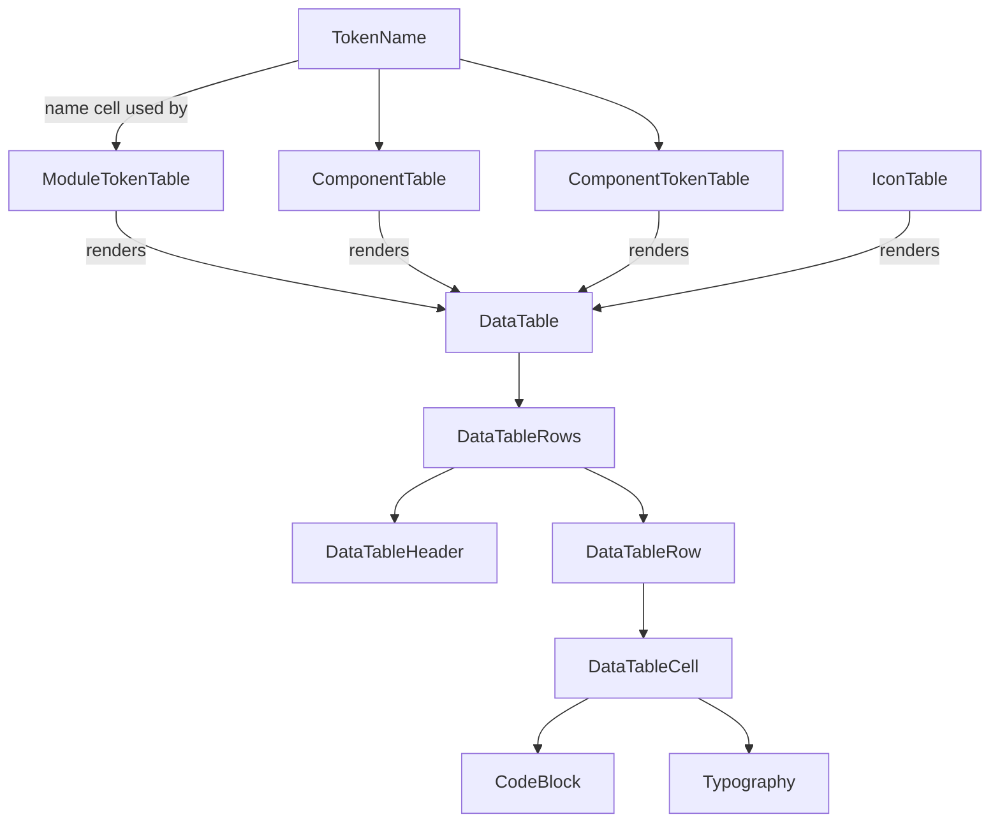

# How the table components relate

No class inheritance. `DataTable` is the base table engine; the other four are
config wrappers that **render `<DataTable>`** with their own columns + rows.

- **DataTable** — base engine: Table → Header + Row → Cell.
- **ModuleTokenTable / ComponentTable / ComponentTokenTable / IconTable** — siblings; each just passes a different `columns` + `rows` into `DataTable`.
- **TokenName** — the shared "name" cell reused by three of them.