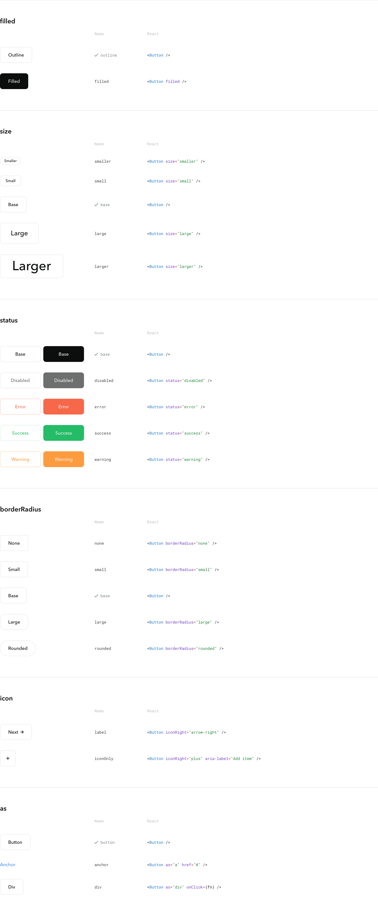

# @niceprototypes/button


> **Responsive props:** Every prop accepts per-breakpoint overrides through the `breakpoints` object. Keys are a breakpoint name (`phone`, `tablet`, `laptop`, `desktop`), optionally with `+` (that breakpoint and up) or `-` (that breakpoint and down); values are partial props. The most specific matching key wins. See [withBreakpoints](https://niceprototypes.com/storybook/?path=/docs/react-styles-withbreakpoints--docs).
>
> ```tsx
> <Button size="small" breakpoints={{ "laptop+": { size: "large" } }}>Save</Button>
> ```

A flexible and customizable React button component with built-in theming support, designed to work seamlessly with the nice-react ecosystem.

> **⚠️ Storybook Notice**: Storybook has been temporarily removed due to React 19 compatibility issues. The Storybook configuration is preserved in the `storybook-preserve` branch and will be restored when Storybook officially supports React 19.

## Features

- **Theming**: styled from the `button.*` component tokens (override with `setTokens({ button: { … } })`); `theme` pins a subtree to `day`, `night` or a custom theme
- **Sizes**: five sizes from `SizeType` — `smaller`, `small`, `base`, `large`, `larger`
- **Statuses**: `base`, `disabled`, `error`, `success`, `warning`; outline by default, solid with `filled`
- **Looks**: `ghost` (transparent at rest or per interaction state), `selected` (persistent selected border), per-state `color` and `iconColor`
- **Icons**: `iconLeft` / `iconRight` through @niceprototypes/icon, vendor (Lucide) names with `iconVendor`; one icon and no label renders a square button
- **Elements**: native `<button>`, `as="a"` (inlined link layout by default), `as="div"` (clickable div with button semantics); `inlined` sets the link layout on any of them
- **Accessibility**: forwarded `aria-*`, `role`, `tabIndex` and `id`; native `disabled` (or `aria-disabled` + `tabIndex` -1); token-driven `:focus-visible` outline; Enter/Space activation on `as="div"`
- **Responsive**: per-breakpoint prop overrides through `breakpoints`
- **TypeScript**: every prop type exported from `Button.types.ts`

## Installation

```bash
npm install @niceprototypes/button
```

### Peer Dependencies

Make sure you have the following peer dependencies installed:

```bash
npm install react react-dom styled-components @niceprototypes/styles @niceprototypes/flex @niceprototypes/ink @niceprototypes/icon
```

## Quick Start

```tsx
import Button from '@niceprototypes/button'

function App() {
  return (
    <Button
      filled
      onClick={() => console.log('Button clicked!')}
    >
      Click me
    </Button>
  )
}
```

## Props Reference

Types are the aliases exported from `Button.types.ts`. Allowed values of each union (resolved): `~/nice/manifest/agents/catalog.json` → `@niceprototypes/button`; aliases imported from @niceprototypes/styles (`SizeType`, `BorderWidthType`, `ThemeType`) stay unresolved there — read `@niceprototypes/styles/src/generated/types.ts`.

| Prop | Type | Default | Description |
|------|------|---------|-------------|
| `onClick` | `ButtonOnClickType` (`() => void`) | - | Click handler. Not called while disabled |
| `filled` | `ButtonFilledType` (`boolean`) | `false` | Status color as background, transparent border, label and icons in `--np--color--inverse`; `false` is the outline (transparent fill, status-colored border and label) |
| `size` | `SizeType` (`"smaller"`, `"small"`, `"base"`, `"large"`, `"larger"`) | `"base"` | Height from `button.size`, horizontal padding from `button.spacing`, label size passed to Ink as `size`, icon size from `button.icon.size` |
| `padding` | `ButtonPaddingType` (`FlexSpacingType`: gap-token shorthand, 1–4 values, e.g. `"none base larger"`) | - | Content padding through @niceprototypes/flex; replaces the size-derived horizontal padding, and non-zero vertical values grow the button past its base height. Ignored on square (icon-only) buttons |
| `grow` | `ButtonGrowType` (`number`) | - | `flex-grow: {value}` with `flex-basis: 0` on the root; needs a flex-container parent. Unset emits no flex-grow |
| `justifyContent` | `ButtonJustifyContentType` (`FlexJustifyContentType`: `"flex-start"`, `"flex-end"`, `"center"`, `"space-between"`, `"space-around"`, `"space-evenly"`) | `"center"` | Placement of the icon(s) and label; anything but `"center"` stretches the content row to the button's width |
| `ghost` | `ButtonGhostType` (`boolean \| { rest?, hover?, focus?, active?: boolean }`) | `false` | Transparent background and border in the given interaction states; `true` = at rest only. Disabled buttons show their rest setting |
| `selected` | `ButtonSelectedType` (`boolean`) | `false` | Persistent selected look. Overrides `ghost` in every state; unfilled, the border reads `button.selected.borderColor` (filled keeps its transparent border); an explicit `borderColor` still wins. Sets no ARIA attribute — pass `aria-pressed`, or `role="tab"` + `aria-selected` |
| `animationDuration` | `ButtonAnimationDurationType` (`"none"`, `"faster"`, `"fast"`, `"base"`, `"slow"`, `"slower"`) | `"base"` | Duration of the button's transitions, from the `button.animationDuration` tokens: each is the root animationDuration of the same name, except `base`, which is the root's `fast` (160ms). `"none"` turns transitions off (0s). Not applied to inlined buttons, which have no transition |
| `color` | `ButtonColorType`: color/border-color token address (`"color:light"`, `"color"`, `"color:link"`), or `{ rest?, hover?, focus?, active? }` of them | the status color | Label color, in every state or per state; wins over the status color (filled and ghost included). Disabled buttons show their rest color; applies to inlined buttons too |
| `iconColor` | `ButtonIconColorType`: color/border-color token address (`"borderColor"`, `"borderColor:stronger"`, `"color:link"`), or `{ rest?, hover?, focus?, active? }` of them | `button.icon.color` state tokens (`base` = the button's text color; `hover`, `focus`, `active` follow `base`) | Icon color, in every state or per state; beats the tokens. Disabled buttons show their rest color; applies to inlined buttons too |
| `status` | `ButtonStatusType` (`"base"`, `"disabled"`, `"error"`, `"success"`, `"warning"`) | `"base"` | Semantic color of label and border (or fill, when `filled`). `"disabled"` also disables the button, as `disabled` does |
| `iconLeft` / `iconRight` | `ButtonIconNameType` (Icon's `name` type: built-in name, or any string) | - | Icon before / after the label; a vendor (Lucide, PascalCase) name resolves with `iconVendor`. Exactly one icon and no `children` renders a square (icon-only) button |
| `iconVendor` | `ButtonIconVendorType` (`boolean`) | `false` | Resolve `iconLeft` / `iconRight` through the vendor icon set (Icon's `vendor` prop) |
| `inlined` | `ButtonInlinedType` (`boolean`) | `true` when `as="a"`, else `false` | Link-like layout: no border, background, height or size-derived padding (a native `<button>`'s browser border, fill and padding are reset too, so it matches an inlined anchor or div), link color. `inlined={false}` gives `as="a"` the full button chrome |
| `weight` | `ButtonWeightType` (`FontWeightType`: `"light"`, `"base"`, `"medium"`, `"semibold"`, `"bold"`, `"extrabold"`, `"black"`) | `"medium"`; Ink's default when inlined | Label font weight, forwarded to Ink |
| `disabled` | `ButtonDisabledType` (`boolean`) | `false` | Disabled coloring; the native `<button>` gets `disabled`, an anchor or div gets `aria-disabled` and `tabIndex` -1, and clicks are suppressed |
| `children` | `React.ReactNode` | - | Label |
| `className` | `ButtonClassNameType` (`string`) | - | Forwarded to the root |
| `type` | `ButtonElementType` (`"button"`, `"submit"`, `"reset"`) | `"button"` | Native `<button>` type. Not passed when `as="a"` or `as="div"` |
| `aria-label` | `ButtonAriaLabelType` (`string`) | - | Forwarded to the root |
| `aria-expanded` | `ButtonAriaExpandedType` (`React.AriaAttributes["aria-expanded"]`) | - | Forwarded to the root |
| `aria-haspopup` | `ButtonAriaHasPopupType` (`React.AriaAttributes["aria-haspopup"]`) | - | Forwarded to the root |
| `aria-controls` | `ButtonAriaControlsType` (`React.AriaAttributes["aria-controls"]`) | - | Forwarded to the root |
| `aria-pressed` | `ButtonAriaPressedType` (`React.AriaAttributes["aria-pressed"]`) | - | Forwarded to the root |
| `aria-selected` | `ButtonAriaSelectedType` (`React.AriaAttributes["aria-selected"]`) | - | Forwarded to the root |
| `aria-current` | `ButtonAriaCurrentType` (`React.AriaAttributes["aria-current"]`) | - | Forwarded to the root, e.g. `"page"` on the current pagination button |
| `form` | `ButtonFormType` (`string`) | - | Id of the `<form>` the native `<button>` belongs to, so a button outside the form (e.g. a dialog footer `type="submit"`) submits it. Not passed when `as="a"` or `as="div"` |
| `role` | `ButtonRoleType` (`React.AriaRole`) | - (`"button"` when `as="div"`) | Forwarded to the root; overrides `as="div"`'s `role="button"` |
| `tabIndex` | `ButtonTabIndexType` (`number`) | - (`0` when `as="div"`) | Forwarded to the root; a disabled button keeps `-1` (anchor, div) or its native `disabled` (button) |
| `id` | `ButtonIdType` (`string`) | - | Forwarded to the root |
| `data-testid` | `ButtonTestIdType` (`string`) | - | Forwarded to the root |
| `antialiased` | `ButtonAntialiasedType` (`boolean`) | `false` | Antialiased label rendering, forwarded to Ink |
| `borderWidth` | `BorderWidthType` (`"none"`, `"smaller"`, `"small"`, `"base"`, `"large"`, `"larger"`) | `"base"` | Border width from `button.borderWidth` |
| `borderRadius` | `ButtonBorderRadiusType` (`"none"`, `"small"`, `"base"`, `"large"`, `"rounded"`) | `"base"` | Corner radius from `button.borderRadius`; `"rounded"` is half the button's height |
| `backgroundImage` | `string` | - | CSS `background-image` value (gradient or `url(...)`) |
| `borderColor` | `ColorTokenProp<ButtonBorderColorType>` (`BorderColorType`: `"base"`, `"subtle"`, `"strong"`, `"stronger"`, `"success"`, `"highlight"`, `"warning"`, `"error"`, `"link"`, or the object form) | the status border color | Border color; token-bound, raw CSS colors are not accepted |
| `theme` | `ThemeType` (`"day"`, `"night"`, or a custom theme name) | - | Pin token resolution to a theme instead of following the color-scheme media query |
| `onMouseEnter` | `ButtonOnMouseEnterType` (`(event: React.MouseEvent<HTMLButtonElement \| HTMLAnchorElement \| HTMLDivElement>) => void`) | - | Called when the pointer enters the button |
| `onMouseLeave` | `ButtonOnMouseLeaveType` (same signature as `onMouseEnter`) | - | Called when the pointer leaves the button |
| `style` | `React.CSSProperties` | - | Inline styles on the root |
| `as` | `ButtonAsType` (`"a"`, `"div"`) | - (native `<button>`) | `"a"`: an anchor, inlined by default (`href` / `target` apply). `"div"`: a clickable `<div>` with full chrome and button semantics (`role="button"`, `tabIndex` 0, Enter/Space activation) |
| `ref` | `ButtonRefType` (`React.Ref<HTMLButtonElement \| HTMLAnchorElement \| HTMLDivElement>`) | - | Ref to the rendered root: `<button>`, `<a>` when `as="a"`, `<div>` when `as="div"` |
| `href` | `ButtonHrefType` (`string`) | - | Link destination when `as="a"`; dropped while disabled |
| `target` | `ButtonTargetType` (`"_blank"`, `"_self"`, `"_parent"`, `"_top"`) | - | Anchor target when `as="a"`; `"_blank"` adds `rel="noopener noreferrer"` |

Icon color per interaction state can also be set for every button at once through the `button.icon.color` component tokens (`base`, `hover`, `focus`, `active`):

```ts
setTokens({ button: { icon: { color: { hover: { day: "#333", night: "#fff" } } } } })
```

An unset state follows `base`; an `iconColor` prop on a button beats the tokens.

The keyboard focus outline (`:focus-visible`) reads the `button.focusRing.width`, `button.focusRing.color` and `button.focusRing.offset` component tokens (`base`).

## Usage Examples

### Status

```tsx
import Button from '@niceprototypes/button'

// Outline (default): transparent fill, status-colored border and label
<Button>Base</Button>
<Button status="success">Success</Button>
<Button status="warning">Warning</Button>
<Button status="error">Error</Button>

// Disabled: either form disables the button and applies the disabled coloring
<Button status="disabled">Disabled</Button>
<Button disabled>Also disabled</Button>
```

### Filled

```tsx
// Status color as background, label and icons in the inverse color
<Button filled>Base</Button>
<Button filled status="success">Saved</Button>
<Button filled status="error" iconLeft="trash">Delete</Button>
```

### Size

```tsx
<Button size="smaller">Smaller</Button>
<Button size="small">Small</Button>
<Button size="base">Base</Button>
<Button size="large">Large</Button>
<Button size="larger">Larger</Button>
```

### Icons

```tsx
// Icon after the label
<Button iconRight="arrow-right">Next step</Button>

// Icon before the label
<Button iconLeft="check">Save changes</Button>

// Both sides; space-between puts the icons at the edges
<Button iconLeft="folder-open" iconRight="carat-bottom" justifyContent="space-between">
  Open file
</Button>

// Icon-only (square) button: one icon, no label
<Button iconLeft="search" aria-label="Search" />

// Vendor (Lucide) icon name
<Button iconLeft="Settings" iconVendor>Settings</Button>

// Icon color per interaction state
<Button iconRight="arrow-right" iconColor={{ rest: "color:light", hover: "color:link" }}>
  Continue
</Button>
```

### Ghost and selected

```tsx
// Transparent background and border at rest; hover, focus and press show the normal look
<Button ghost>Ghost</Button>

// Ghost in chosen interaction states only
<Button ghost={{ rest: true, hover: true }}>Ghost until focus or press</Button>

// Toggle group: selected overrides ghost and takes the button.selected.borderColor border
<Button ghost selected={isBold} aria-pressed={isBold} onClick={toggleBold}>Bold</Button>

// Tab
<Button role="tab" aria-selected={isActive} tabIndex={isActive ? 0 : -1} selected={isActive}>
  Overview
</Button>
```

### Links and other elements

```tsx
// Anchor, inlined (link layout) by default
<Button as="a" href="/docs">Read the docs</Button>

// Anchor with full button chrome
<Button as="a" href="/signup" target="_blank" inlined={false} filled>Sign up</Button>

// Clickable div with button semantics (role="button", tabIndex 0, Enter/Space)
<Button as="div" onClick={handleClick}>Div button</Button>
```

### Layout

```tsx
// Equal-width buttons in a flex row
<Flex direction="row" gap="base">
  <Button grow={1}>Cancel</Button>
  <Button grow={1} filled>Confirm</Button>
</Flex>

// Custom padding (gap-token shorthand)
<Button padding="small larger">Wide</Button>

// Rounded corners, thicker border
<Button borderRadius="rounded" borderWidth="large">Pill</Button>
```

### Theming

```tsx
import { setTokens } from '@niceprototypes/styles'

// Restyle every button through the component tokens
setTokens({ button: { selected: { borderColor: { day: "#333", night: "#fff" } } } })

// Pin one button to the night theme
<Button theme="night" filled>Night</Button>
```

## Tokens

Component tokens live in `@niceprototypes/styles/src/tokens/components/button.json` and are read with `getToken("button.{group}:{variant}")`. Each emits a CSS custom property `--np--button--{group}--{variant}`, with camelCase groups in kebab-case; the `base` variant contributes no segment (`button.size:base` → `--np--button--size`). Override them with `setTokens({ button: { … } })`.

| Token group | Variants | CSS variables |
|-------------|----------|---------------|
| `size` | `smaller`, `small`, `base`, `large`, `larger` | `--np--button--size`, `--np--button--size--{variant}` |
| `spacing` | `smaller`, `small`, `base`, `large`, `larger` | `--np--button--spacing`, `--np--button--spacing--{variant}` |
| `borderRadius` | `none`, `smaller`, `small`, `base`, `large`, `larger`, `rounded` | `--np--button--border-radius`, `--np--button--border-radius--{variant}` |
| `borderWidth` | `none`, `smaller`, `small`, `base`, `large`, `larger` | `--np--button--border-width`, `--np--button--border-width--{variant}` |
| `borderColor` | `base`, `subtle`, `strong`, `stronger`, `success`, `highlight`, `warning`, `error`, `link` | `--np--button--border-color`, `--np--button--border-color--{variant}`, each with an `--inverse` form |
| `icon.color` | `base`, `hover`, `focus`, `active` | `--np--button--icon--color`, `--np--button--icon--color--{variant}` |
| `icon.size` | `smaller`, `small`, `base`, `large`, `larger` | `--np--button--icon--size`, `--np--button--icon--size--{variant}` |
| `animationDuration` | `none`, `faster`, `fast`, `base`, `slow`, `slower` | `--np--button--animation-duration`, `--np--button--animation-duration--{variant}` |
| `animationEasing` | `base` | `--np--button--animation-easing` |
| `selected.borderColor` | `base` | `--np--button--selected--border-color`, `--np--button--selected--border-color--inverse` |
| `focusRing.width` | `base` | `--np--button--focus-ring--width` |
| `focusRing.color` | `base` | `--np--button--focus-ring--color`, `--np--button--focus-ring--color--inverse` |
| `focusRing.offset` | `base` | `--np--button--focus-ring--offset` |

The `--inverse` forms are derived for tokens that alias a core color with an inverse.

## Accessibility

The component includes built-in accessibility features:

- Proper ARIA attributes
- Keyboard navigation support
- Focus management
- Screen reader compatibility

```tsx
<Button
  aria-label="Save document"
  data-testid="save-button"
>
  Save
</Button>
```

## Advanced Usage

### Custom Styling

You can extend the button with custom styles:

```tsx
import styled from 'styled-components'
import Button from '@niceprototypes/button'

const CustomButton = styled(Button)`
  box-shadow: 0 4px 6px rgba(0, 0, 0, 0.1);

  &:hover {
    box-shadow: 0 8px 15px rgba(0, 0, 0, 0.2);
  }
`
```

### Form Integration

```tsx
<form id="profile" onSubmit={handleSubmit}>
  <Button type="submit" filled>
    Submit Form
  </Button>

  <Button type="reset">
    Reset Form
  </Button>
</form>

// Outside the form (e.g. a dialog footer): submits it through `form`
<Button type="submit" form="profile" filled>Save</Button>
```

## Migration from helpshelf-ui

If you're migrating from the internal Button component:

1. Install `@niceprototypes/button`
2. Update your imports:
   ```tsx
   // Before
   import Button from '@/components/Button'

   // After
   import Button from '@niceprototypes/button'

   // Icons are set by side
   <Button iconRight="arrow-right">
     Click me
   </Button>
   ```

## Development

```bash
# Install dependencies
npm install

# Start development mode
npm run dev

# Run tests
npm test

# Build for production
npm run build

```

## Contributing

We welcome contributions! Please see our [Contributing Guide](CONTRIBUTING.md) for details.

## License

MIT © Nice Prototypes
