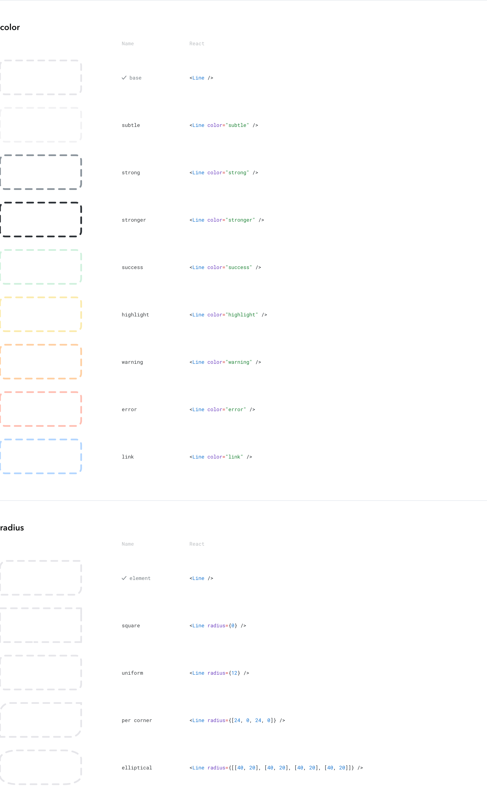

# nice-react-line


A dashed line that frames its parent element: pill-shaped dashes, each with its own rim,
centered on the parent's edge and following its corners. The dash pattern is fitted so a
whole number of dashes goes around, at any size.

Line is a frame, not a divider. It fills and outlines its nearest positioned ancestor, so its
parent must be positioned (`relative`, `absolute`, `fixed` or `sticky`). Under a statically
positioned parent it frames whatever ancestor is positioned, up to the whole viewport. In
development, Line logs one `console.warn` per instance when its parent's computed position is
`static`.

## Install

```sh
npm install nice-react-line
```

Peer dependencies: `nice-react-styles`, `react`, `react-dom`, `styled-components`.

## Usage

```tsx
import Line from "nice-react-line"

// Line fills its positioned parent and draws on the parent's edge.
<div style={{ position: "relative", borderRadius: 12 }}>
  Content
  <Line />
</div>

<Line color="link" />
<Line radius={8} />
<Line radius={[24, 0, 24, 0]} />
<Line radius={someOtherElement} /> // that element's corners, for a Line laid over it
```

## Props

| Prop | Type | Default | |
|---|---|---|---|
| `color` | border-color variant (`base`, `subtle`, `strong`, `stronger`, `success`, `highlight`, `warning`, `error`, `link`) | `base` | Dash color |
| `radius` | `"element"`, an Element, a number, or four corners (`number` or `[horizontal, vertical]`) | `"element"` | Corner radii; `"element"` reads the parent's own |
| `className` | `string` | | Applied to the root element |
| `theme` | `ThemeType` | | Pins token resolution to a theme |

## Tokens

All from `nice-styles` (`src/tokens/components/line.json`); override any of them on an
ancestor to restyle Line without props.

| Token | Default |
|---|---|
| `--np--line--border-color` (+ variants) | `var(--np--border-color)` |
| `--np--line--rim-color` | white |
| `--np--line--width` | `4px` |
| `--np--line--rim-width` | `1.5px` |
| `--np--line--dash-length` | `18px` (round ends included) |
| `--np--line--gap` | `5px` (between rims) |

Docs: nice-storybook → Components → Line.
