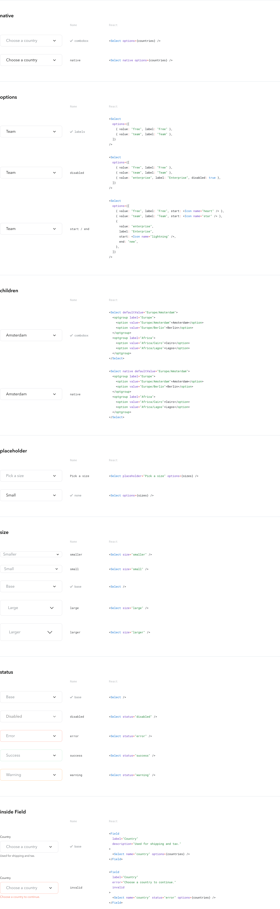

# nice-react-select


Select for React, rendered through `nice-react-input`'s field chrome. Part of
the Nice Prototypes ecosystem.

- **Default (custom):** a WAI-ARIA APG
  [select-only combobox](https://www.w3.org/WAI/ARIA/apg/patterns/combobox/examples/combobox-select-only/)
  — Input rendered read-only with `role="combobox"`, opening a
  `nice-react-popover` Popover that holds a `nice-react-list` List with
  `role="listbox"`. Options can carry `start` / `end` content.
- **`native`:** the platform `<select>` (Input `as="select"`), with options, a
  placeholder option and a chevron.

Single value only in both modes (no `multiple`).

## Install

```bash
npm install nice-react-select
```

Peer dependencies: `react`, `react-dom` (>=19.2), `styled-components` (>=6.1.18).

## Usage

### Options

```tsx
import Select from "nice-react-select"

<Select
  aria-label="Fruit"
  placeholder="Pick a fruit"
  options={[
    { value: "apple", label: "Apple", start: <Icon name="apple" /> },
    { value: "banana", label: "Banana", disabled: true },
    { value: "cherry", label: "Cherry", end: "new" },
  ]}
  onChange={(value, event) => setFruit(value)}
/>
```

### Native

```tsx
<Select native aria-label="Fruit" defaultValue="kiwi">
  <optgroup label="Stone fruit">
    <option value="peach">Peach</option>
  </optgroup>
  <option value="kiwi">Kiwi</option>
</Select>
```

### Children

`<option>` / `<optgroup>` children are accepted in both modes; when both
`children` and `options` are given, `children` win. In custom mode each
`<option value disabled>label</option>` becomes a listbox option (the value
falls back to the option text when `value` is absent); `<optgroup>` is
flattened — its options are kept, the group heading is not rendered, and a
disabled group disables its options; other children are ignored. `options` is
preferred in custom mode: it also carries `start` / `end`.

### Inside a Field

```tsx
import { Field } from "nice-react-field"

<Field label="Fruit" description="Pick one." error={error} invalid={!!error} required>
  <Select options={fruit} />
</Field>
```

Field wiring comes from Input: the label targets the control (the combobox
input, or the native `<select>`), `aria-describedby` is ordered
`[description, error, consumer]`, and `aria-invalid` / `required` follow the
Field. In custom mode the listbox is labelled by the control's `<label>`
(`aria-labelledby`), or by `aria-label` when there is no label.

## Props

`SelectProps` is a union discriminated on `native`:

- **custom** (`native` omitted / `false`): extends Input's `as="input"` props
  minus the ones Select sets (`as`, `type`, `end`, `readOnly`, `role`,
  `aria-expanded`, `aria-controls`, `aria-activedescendant`, `aria-haspopup`,
  `aria-autocomplete`). `ref` is the combobox `HTMLInputElement`.
- **native** (`native: true`): extends Input's `as="select"` props minus `as`
  and `end`. `ref` is the `HTMLSelectElement`.

Every other inherited prop (`status`, `filled`, `borderRadius`, `borderWidth`,
`width`, `backgroundColor`, `borderColor`, `start`, `className`, `style`,
`theme`, `id`, `required`, …) passes through to Input unchanged.

| Prop | Type | Notes |
|---|---|---|
| `native` | `boolean` | `true` renders the platform `<select>`. Default `false` (custom combobox) |
| `options` | `ReadonlyArray<SelectOptionType>` | `{ value: string; label: ReactNode; disabled?; start?; end? }`, in order. `start` / `end` render in custom mode only. A native `<option>` renders text only — pass string labels. Custom mode shows / typeahead-matches the label when it is a string or number, otherwise the value |
| `children` | `ReactNode` | `<option>` / `<optgroup>`; win over `options` (see Children) |
| `placeholder` | `string` | Shown while the value is `""`. Native: a first `<option value="" disabled hidden>`. Custom: the combobox's `placeholder` |
| `value` / `defaultValue` | `string` | Controlled / uncontrolled value. Without either, the value starts at `""` with a placeholder, otherwise at the first enabled option (both modes) |
| `onChange` | `(value: string, event?) => void` | Native: the `<select>` change event. Custom: the keyboard event (Enter, Space, Tab, Alt+ArrowUp) or option click that selected, and only when the value changes |
| `name` | `string` | Native: on the `<select>`. Custom: on a hidden `<input type="hidden">` carrying the value (the combobox has no name) |
| `size` | `SizeType` | Field chrome, chevron and listbox item size. Default `"base"` |
| `width` | `InputWidthType` | Field chrome width, passed to Input (`input.width` scale). Default `"full"`. In custom mode the listbox is at least as wide as the field |
| `status` | `InputStatusType` | `"disabled"` disables the control (it cannot open) and dims the chevron (`color:disabled`) |
| `disabled` | `boolean` | Same effect as `status="disabled"`; either one disables |
| `className`, `theme`, `breakpoints` | | Standard. `className` lands on Input's wrapper; `theme` is applied by Input around the field (and to the Popover in custom mode) |

The chevron (`carat-bottom` icon) sits in Input's `end` slot, `aria-hidden`.
Native: `pointer-events: none`. Custom: clicking it toggles the listbox and
keeps focus on the combobox.

## Custom mode — keyboard

Focus stays on the combobox throughout; the active option is exposed with
`aria-activedescendant` and scrolled into view.

| Key | Closed | Open |
|---|---|---|
| `ArrowDown` / `ArrowUp` | Open; active = selected option (else first enabled) | Next / previous enabled option; no wrap |
| `Alt+ArrowDown` | Open | Next enabled option |
| `Alt+ArrowUp` | — | Select the active option and close |
| `Enter` | Open | Select the active option and close |
| `Space` | Open | Select the active option and close (part of the search while a typeahead run is in progress) |
| `Home` / `End` | Open on the first / last enabled option | First / last enabled option |
| `PageUp` / `PageDown` | — | 10 options up / down (clamped, skipping disabled) |
| `Escape` | — | Close without changing the value |
| `Tab` | — (focus moves) | Select the active option, close; focus moves on |
| Printable characters | Open on the first matching option | Move to the matching option |

Typeahead matches option text by prefix (case-insensitive), searching after
the current option and wrapping; characters typed within 500 ms build one
search string, and repeating a single character cycles through its matches.
Disabled options are skipped. Blur closes without changing the value.

Pointer: clicking the combobox or chevron toggles; clicking an enabled option
selects it and closes; moving the pointer over an enabled option makes it
active; a pointerdown outside closes without change.

## Form submission

Native mode submits and validates like any `<select>`.

Custom mode submits `name=value` through a hidden input, so `FormData` and
native form posts work. **`required` is not validated natively in custom
mode**: `required` (or a Field's `required`) is rendered on the read-only
combobox — assistive technology announces it as required — but browsers do
not run constraint validation on read-only controls or hidden inputs, so the
form submits with an empty value. Validate in your own submit handler (and
show the error through Field), or use `native`. This is the same limitation as
`nice-react-calendar`'s DateField.

## Tokens

`select.chevron.size:{size}` — chevron size per `size`. The chrome uses
Input's tokens, the popup surface Popover's, and the listbox List's (`list.*`).

## License

MIT
